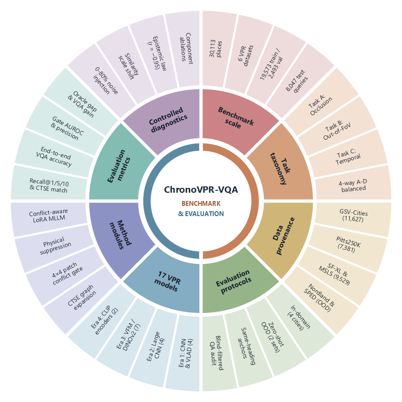
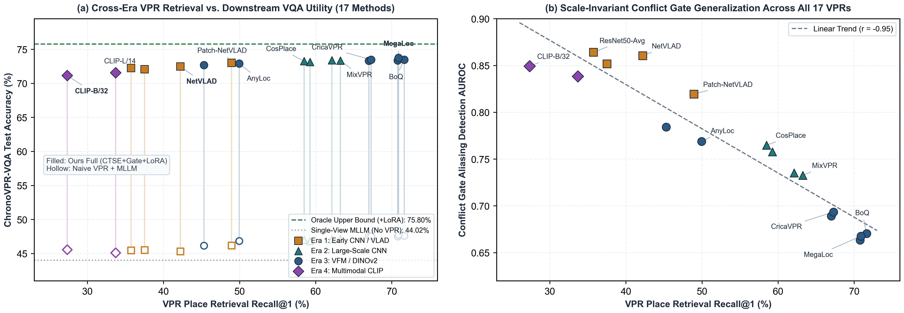

<div align="center">

# Beyond Appearance Lookup: Epistemically Gated Chrono-Topological Visual Place Recognition as Spatio-Temporal Memory for Multimodal Reasoning

[-00629B.svg)](#citation)
[](https://www.python.org/)
[](https://pytorch.org/)
[-2B9348.svg)](data/DATASET_CARD.md)
[](LICENSE)
[](data/DATASET_CARD.md)

</div>

<p align="center">
  
</p>

> **Official implementation, benchmark annotations (`ChronoVPR-VQA`), trained checkpoints, and complete 17-method (4-era, 2016–2025) evaluation suite** for *"Beyond Appearance Lookup: Epistemically Gated Chrono-Topological Visual Place Recognition as Spatio-Temporal Memory for Multimodal Reasoning"*.

---

## News & Highlights

- **[Benchmark Release]** `ChronoVPR-VQA` (30,113 blind-filtered unique physical places across 6 canonical VPR datasets: **GSV-Cities, Pittsburgh250K, SF-XL, MSLS, Nordland [Zero-Shot OOD], and SPED [Zero-Shot OOD]**) is included in [`data/annotations/`](data/annotations/).
- **[Universal Plug-and-Play Gains]** Across **17 VPR methods spanning four technological eras (2016–2025)** on all 8,047 test queries, our framework achieves **+25.59% to +27.18%** absolute VQA accuracy improvements over naive VPR+MLLM—peaking at **73.75%** with MegaLoc (within **2.05%** of the 75.80% Oracle ceiling).
- **[Epistemic Compensation Law ($r = -0.95$)]** A single frozen, similarity-free **Scale-Invariant Conflict Resolution Gate** (`checkpoints/conflict_gate_best.pt`, 2.1 MB) transfers zero-shot across all 17 VPR backbones, achieving its highest aliasing-detection AUROC on noisier legacy retrievers (**0.8642** on ResNet50-Avg, **0.8605** on NetVLAD) and compressing a **44.29-point** VPR Recall@1 chasm into just **2.59 points** of downstream VQA spread!

---

## Core Research Problem & Framework Overview

Naive *"top-1 appearance lookup"* VPR+MLLM cascades fail strikingly (e.g., SOTA BoQ attains 71.63% Recall@1 yet only 47.60% VQA accuracy—barely +3.58% above a single-view MLLM) due to **three violated theoretical premises**:

1. **The Similarity–Complementarity Paradox:** Standard VPR maximizes appearance overlap, returning redundant same-heading views rather than visually disjoint yet topologically complementary views ($<0.9\%$ exact out-of-FoV recovery across all 17 VPR methods).
2. **Perceptual-Aliasing Visual Poisoning:** Unfiltered VPR false positives inject geographically false visual tokens into MLLM cross-attention, actively corrupting predictions unless physically suppressed and jointly calibrated.
3. **Geometric–Semantic Decoupling & Retriever Scale Shift:** Vision-language encoders (CLIP) suffer severe geometric localization collapse (27.34%–33.69% R@1), while raw top-1 cosine medians shift $16.5\times$ across architectures ($0.054 \to 0.893$).

<p align="center">
  
</p>

Our four-stage architecture leaves any VPR backbone **completely frozen and plug-and-play**:
- **Stage 1 — Multimodal Encoding & Spatio-Temporal Intent Parsing:** Extracts frozen VPR descriptors alongside structured occlusion, yaw ($\Delta\theta$), and temporal ($\Delta t$) reasoning intents.
- **Stage 2 — Chrono-Topological Sub-Graph Expansion (CTSE):** Decouples physical place anchoring from intent-guided angular/temporal traversal over the geo-tagged memory graph, boosting exact out-of-FoV complementary view recovery from **<0.9% to 98.3%** at **<0.1 ms** latency.
- **Stage 3 — Scale-Invariant Neural Conflict Resolution Gate:** Verifies cross-view $4\times 4$ dense DINOv2-ViT-B/14 spatial patch correlation matrices ($\mathbf{C} = \mathbf{G}_q\mathbf{G}_m^\top$) without raw VPR similarity, physically suppressing aliased retrievals below $\tau = 0.45$.
- **Stage 4 — Conflict-Aware Spatio-Temporal LoRA Calibration:** Conditions a lightweight LoRA-calibrated Qwen2.5-VL-7B reasoner ($r=16$, 0.57% trainable parameters) on verified $(I_q, I_{\text{ctse}}, \Delta\theta, \Delta t, r, q_{\text{focus}})$ cues.

---

## The `ChronoVPR-VQA` Benchmark

<p align="center">
  
</p>

`ChronoVPR-VQA` spans **30,113 unique physical places** across **6 canonical VPR datasets** and **3 physical-horizon reasoning tasks** (**Task A:** Occlusion Recovery, **Task B:** Out-of-FoV Topological Reasoning, **Task C:** Longitudinal Temporal Evolution), strictly blind-filtered against single-view guessing with uniform 25% A/B/C/D option balance. **Nordland** and **SPED** are strictly held out for zero-shot out-of-domain evaluation. See [`data/DATASET_CARD.md`](data/DATASET_CARD.md) for the complete schema, city statistics, and upstream image preparation guide.

| Benchmark | Total | Train | Val | Test | Primary Shift | Tasks |
| :--- | :---: | :---: | :---: | :---: | :--- | :---: |
| **GSV-Cities** | 11,627 | 9,331 | 1,148 | 1,148 | Multi-year urban (23 cities) | A, C |
| **Pittsburgh250K** | 7,381 | 3,098 | 419 | 3,864 | $360^\circ$ panoramic intersections | A, B |
| **SF-XL** | 5,974 | 4,764 | 605 | 605 | Multi-heading & temporal | A, B, C |
| **MSLS** | 3,555 | 2,380 | 321 | 854 | Multi-city sequences | A, C |
| **Nordland** *(Zero-Shot OOD)* | 1,347 | 0 | 0 | 1,347 | 4-season railway shift | A, C |
| **SPED** *(Zero-Shot OOD)* | 229 | 0 | 0 | 229 | Extreme weather / night | A, C |
| **Total** | **30,113** | **19,573** | **2,493** | **8,047** | **6 Canonical Benchmarks** | **A, B, C** |

---

## Main Benchmark Results Across 17 VPR Methods (4 Eras, 2016–2025)

<p align="center">
  
</p>

All 17 VPR encoders share the **identical frozen Conflict Gate (`conflict_gate_best.pt`)** and **LoRA Reasoner (`Qwen2.5-VL-7B + LoRA`)** with **zero per-backbone retraining** on all $N = 8,047$ test queries (deterministic greedy decoding, $T = 0.0$):

| Era | VPR Method | VPR R@1 (%) | Gate AUROC | Naive VPR+MLLM (%) | **Ours Full (%)** | **Abs. Gain** |
| :--- | :--- | :---: | :---: | :---: | :---: | :---: |
| *Baseline* | Single-View MLLM (No VPR) | — | — | 44.02 | — | — |
| **Era 1** (2016–21) | ResNet50-Avg | 35.73 | **0.8642** | 45.48 | 72.26 | +26.78 |
| **Era 1** (2016–21) | ResNet50-GeM | 37.50 | 0.8518 | 45.52 | 72.09 | +26.57 |
| **Era 1** (2016–21) | NetVLAD | 42.20 | 0.8605 | 45.31 | 72.49 | **+27.18** |
| **Era 1** (2016–21) | Patch-NetVLAD | 48.94 | 0.8221 | 46.18 | 73.03 | +26.85 |
| **Era 2** (2022–23) | CosPlace | 58.48 | 0.7648 | 46.46 | 73.17 | +26.71 |
| **Era 2** (2022–23) | EigenPlaces | 59.25 | 0.7578 | 46.63 | 73.12 | +26.49 |
| **Era 2** (2022–23) | Conv-AP | 62.11 | 0.7429 | 46.99 | 73.24 | +26.25 |
| **Era 2** (2022–23) | MixVPR | 63.25 | 0.7327 | 47.00 | 73.11 | +26.11 |
| **Era 3** (2023–25) | DINOv2-ViT-B/14 | 45.30 | 0.8313 | 46.02 | 72.46 | +26.44 |
| **Era 3** (2023–25) | AnyLoc | 49.94 | 0.8105 | 46.18 | 72.81 | +26.63 |
| **Era 3** (2023–25) | SelaVPR | 66.97 | 0.7155 | 47.41 | 73.48 | +26.07 |
| **Era 3** (2023–25) | CricaVPR | 67.27 | 0.6951 | 47.20 | 73.44 | +26.24 |
| **Era 3** (2023–25) | DINOv2-SALAD | 70.77 | 0.6634 | 47.57 | 73.63 | +26.06 |
| **Era 3** (2023–25) | BoQ-DINOv2 | **71.63** | 0.6704 | 47.60 | 73.47 | +25.87 |
| **Era 3** (2023–25) | MegaLoc | 70.88 | 0.6677 | 47.76 | **73.75** | +25.99 |
| **Era 4** (Semantic) | CLIP-ViT-B/32 | 27.34 | 0.8493 | 45.12 | 71.16 | +26.04 |
| **Era 4** (Semantic) | CLIP-ViT-L/14 | 33.69 | 0.8385 | 45.73 | 71.32 | +25.59 |
| *Upper Bound* | Oracle GT Memory (+LoRA) | 100.00 | — | — | *75.80* | — |

---

## Repository Structure

```text
ChronoVPR-VQA/
├── README.md                              # Project overview, benchmark results & reproduction guide
├── LICENSE                                # MIT License (code) & CC-BY-4.0 notice (annotations)
├── requirements.txt                       # Python dependencies
├── assets/                                # High-resolution figures for documentation
│   ├── teaser.png
│   ├── framework.png
│   ├── benchmark_sunburst.png
│   └── scaling_law.png
├── data/
│   ├── DATASET_CARD.md                    # Complete benchmark documentation & image mapping guide
│   ├── dataset_stats_clean.json           # Exact summary statistics (30,113 samples)
│   ├── sample_preview.json                # Lightweight human-readable preview
│   └── annotations/                       # Full blind-filtered train / val / test JSON splits
│       ├── chrono_vpr_vqa_train.json      # 19,573 samples
│       ├── chrono_vpr_vqa_val.json        #  2,493 samples
│       └── chrono_vpr_vqa_test.json       #  8,047 samples
├── checkpoints/
│   ├── README.md                          # Model Zoo & LoRA download instructions
│   ├── conflict_gate_best.pt              # Frozen universal 17-method Conflict Gate (2.1 MB)
│   └── lora_adapter_config.json           # Qwen2.5-VL-7B LoRA config (r=16, alpha=32)
├── results/
│   ├── final_paper_results.json           # Complete 17-method VQA, ablation & noise stress logs
│   ├── conflict_gate_eval_summary.json    # Complete 17-method Conflict Gate AUROC/TNR logs
│   └── appendix_computed_stats.json       # Per-benchmark, per-task, yaw & temporal audits
├── src/
│   ├── dataset_construction/              # Topology pairing, QA generation & blind filtering
│   ├── vpr_retrieval/                     # 17 VPR backbones (4 Eras) + CTSE sub-graph expansion
│   ├── conflict_gate/                     # Scale-invariant 4x4 DINOv2 Conflict Gate training & scoring
│   ├── mllm_reasoner/                     # Conflict-aware LoRA Qwen2.5-VL-7B training & vLLM eval
│   └── analysis/                          # Paper/Appendix table & figure reproduction scripts
└── scripts/
    ├── verify_dataset.py                  # Quick dataset integrity & split-balance verifier
    └── run_full_pipeline.sh               # End-to-end 4-stage pipeline script
```

---

## Installation

```bash
git clone https://github.com/<your-username>/ChronoVPR-VQA.git
cd ChronoVPR-VQA

conda create -n chronovpr python=3.11 -y
conda activate chronovpr

# Install PyTorch (CUDA 12.1+ recommended)
pip install torch torchvision --index-url https://download.pytorch.org/whl/cu121

# Install all project dependencies
pip install -r requirements.txt
```

Verify the bundled `ChronoVPR-VQA` annotations immediately after cloning:
```bash
python scripts/verify_dataset.py
```

---

## Reproducing Experiments (4-Stage Pipeline)

Set your local workspace root (where upstream VPR imagery and cached checkpoints reside):
```bash
export CHRONOVPR_ROOT=$(pwd)
```

### Stage 1: 17-Method VPR Retrieval & CTSE Sub-Graph Expansion
All 17 VPR checkpoints are automatically fetched from official upstream repositories (PyTorch Hub / Hugging Face / OpenCLIP):
```bash
python src/vpr_retrieval/run_vpr_gallery_and_ctse.py
python src/vpr_retrieval/run_remaining_vpr_backbones.py
```

### Stage 2: Scale-Invariant Conflict Resolution Gate (Train or Zero-Shot Score)
You can directly use our released frozen checkpoint [`checkpoints/conflict_gate_best.pt`](checkpoints/conflict_gate_best.pt) (Val AUROC **0.8737**), or retrain from scratch on a single GPU (~3 minutes after DINOv2 feature caching):
```bash
# Train from scratch
python src/conflict_gate/train_conflict_gate.py

# Zero-shot score any new VPR method's retrieval log
python src/conflict_gate/score_vpr_retrievals.py
```

### Stage 3: Conflict-Aware LoRA MLLM Calibration
Fine-tunes Qwen2.5-VL-7B-Instruct with rank-16 LoRA (`0.57%` trainable parameters, ~74 min on a single RTX 4080 32GB in BF16):
```bash
python src/mllm_reasoner/train_lora_reasoner.py --num_train_samples 3600 --lr 1.5e-4 --grad_accum 8
```

### Stage 4: Full 8,047-Query Deterministic Evaluation & Analysis
Evaluates Single-View, Naive VPR+MLLM, Zero-Shot CTSE+Gate, Full LoRA across all 17 VPR methods, ablations, and 0%–80% aliasing noise stress tests via vLLM greedy decoding ($T=0.0$):
```bash
python src/mllm_reasoner/evaluate_full_benchmark.py
python src/analysis/compute_paper_tables.py
python src/analysis/plot_main_figures.py
```

---

## Checkpoints & Pre-Computed Results

| Artifact | Location / Size | Notes |
| :--- | :--- | :--- |
| **Conflict Resolution Gate** | [`checkpoints/conflict_gate_best.pt`](checkpoints/conflict_gate_best.pt) (2.1 MB) | Included directly in repo; universal across all 17 VPR methods |
| **LoRA MLLM Adapter** | See [`checkpoints/README.md`](checkpoints/README.md) (190 MB) | Host via GitHub Releases / Hugging Face Hub (>100 MB GitHub file limit) |
| **17-Method Paper Results** | [`results/final_paper_results.json`](results/final_paper_results.json) | Exact numbers for all main paper & appendix tables |

---

## Citation

If you find `ChronoVPR-VQA`, CTSE, or the Scale-Invariant Conflict Resolution Gate useful in your research, please cite:

```bibtex
@article{chronovpr2026tpami,
  title   = {Beyond Appearance Lookup: Epistemically Gated Chrono-Topological Visual Place Recognition as Spatio-Temporal Memory for Multimodal Reasoning},
  author  = {First Author and Second Author and Third Author},
  journal = {IEEE Transactions on Pattern Analysis and Machine Intelligence (TPAMI)},
  year    = {2026},
  note    = {Under Review}
}
```

---

## License & Acknowledgements

- **Source Code:** Released under the [MIT License](LICENSE).
- **Benchmark Annotations (`ChronoVPR-VQA`):** Released under **CC-BY-4.0**. Raw street-view imagery remains subject to the upstream academic licenses of **GSV-Cities**, **Pittsburgh250K**, **SF-XL**, **MSLS**, **Nordland**, and **SPED** (no raw imagery is redistributed in this repository).
- We gratefully acknowledge the authors of NetVLAD, GeM, Patch-NetVLAD, CosPlace, EigenPlaces, Conv-AP, MixVPR, DINOv2, AnyLoc, SelaVPR, CricaVPR, SALAD, BoQ, MegaLoc, CLIP, and Qwen2.5-VL for open-sourcing their models and benchmarks.
