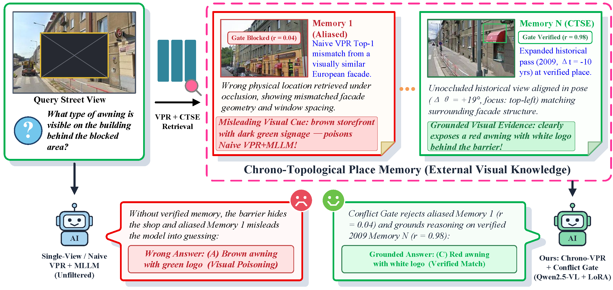
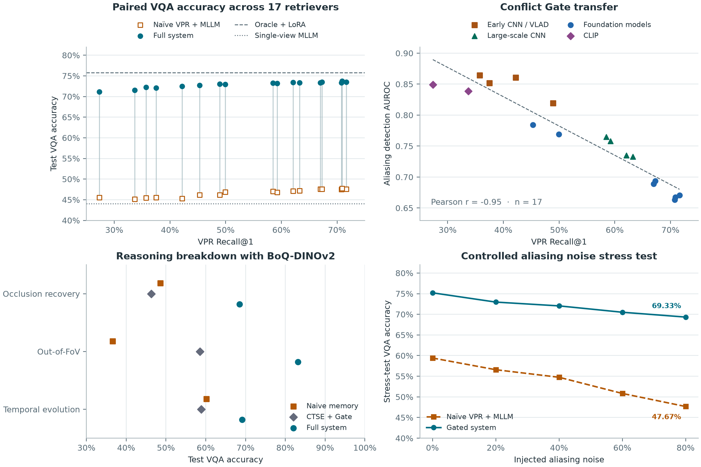
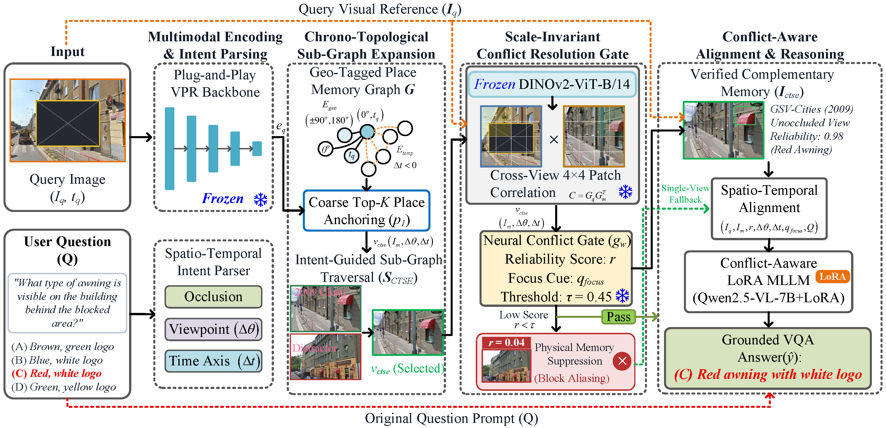

<div align="center">

# ChronoVPR-VQA

**Beyond Appearance Lookup**

*Epistemically Gated Chrono-Topological Visual Place Recognition as Spatio-Temporal Memory for Multimodal Reasoning*

[Project Page](https://cv4ra.github.io/ChronoVPR-VQA/) 

[](LICENSE)
[](data/DATASET_CARD.md)
[](data/dataset_stats_clean.json)

</div>

## Overview

A single street view can hide a storefront behind an occluder, miss a landmark outside the camera's field of view, or show a place years after the event a question asks about. ChronoVPR-VQA treats georeferenced street views as a spatio-temporal memory. A frozen visual place recognition (VPR) model anchors the search, Chrono-Topological Sub-Graph Expansion (CTSE) selects a complementary view, a Conflict Gate scores the reliability of that view, and a calibrated vision–language model reasons over the resulting evidence.

<p align="center"></p>

## Main results

| Result | Value | Evaluation setting |
| --- | ---: | --- |
| Best full-system VQA accuracy | **73.75%** | MegaLoc, 8,047 test questions |
| Gain over naïve VPR + MLLM | **+25.59 to +27.18 pp** | Paired comparisons across 17 frozen retrievers |
| Oracle VQA accuracy | **75.80%** | Ground-truth memory with the LoRA-calibrated reasoner |
| VPR Recall@1 vs. full-system VQA spread | **44.29 vs. 2.59 pp** | Max–min across 17 retrievers |
| Best test Conflict Gate AUROC | **0.8642** | ResNet50-Avg, shared frozen gate |
| Gate AUROC vs. VPR Recall@1 | **Pearson r ≈ −0.95** | 17 method-level pairs |

<p align="center"></p>

The full system reaches **83.13%** on out-of-field-of-view questions with BoQ-DINOv2, up from **36.60%** for the naïve cascade. At **80% injected aliasing noise**, the separate stress test reports **69.33%** gated accuracy and **47.67%** naïve accuracy.

The figure and tables use the committed [VQA results](results/final_paper_results.json), [gate summary](results/conflict_gate_eval_summary.json), and [appendix statistics](results/appendix_computed_stats.json). Accuracy and Recall@1 are percentages. Gains are absolute percentage points (pp). Gate AUROC is on a 0–1 scale.

### Full 17-retriever comparison

| Family | Retriever | Recall@1 | Gate AUROC | Naïve VQA | Full VQA | Gain (pp) |
| --- | --- | ---: | ---: | ---: | ---: | ---: |
| Early CNN / VLAD | ResNet50-Avg | 35.73% | 0.8642 | 45.48% | 72.26% | +26.78 |
| Early CNN / VLAD | ResNet50-GeM | 37.50% | 0.8518 | 45.52% | 72.09% | +26.57 |
| Early CNN / VLAD | NetVLAD | 42.20% | 0.8605 | 45.31% | 72.49% | +27.18 |
| Early CNN / VLAD | Patch-NetVLAD | 48.94% | 0.8194 | 46.18% | 73.03% | +26.85 |
| Large-scale CNN | CosPlace | 58.48% | 0.7648 | 47.02% | 73.27% | +26.25 |
| Large-scale CNN | EigenPlaces | 59.25% | 0.7578 | 46.82% | 73.16% | +26.34 |
| Large-scale CNN | Conv-AP | 62.11% | 0.7352 | 47.11% | 73.41% | +26.30 |
| Large-scale CNN | MixVPR | 63.25% | 0.7327 | 47.16% | 73.36% | +26.20 |
| Foundation models | DINOv2-ViT-B/14 | 45.30% | 0.7843 | 46.15% | 72.70% | +26.55 |
| Foundation models | AnyLoc | 49.94% | 0.7689 | 46.84% | 72.92% | +26.08 |
| Foundation models | SelaVPR | 66.97% | 0.6891 | 47.61% | 73.34% | +25.73 |
| Foundation models | CricaVPR | 67.27% | 0.6935 | 47.56% | 73.49% | +25.93 |
| Foundation models | DINOv2-SALAD | 70.77% | 0.6634 | 47.51% | 73.37% | +25.86 |
| Foundation models | BoQ-DINOv2 | 71.63% | 0.6704 | 47.60% | 73.47% | +25.87 |
| Foundation models | MegaLoc | 70.88% | 0.6677 | 47.76% | 73.75% | +25.99 |
| CLIP | CLIP-ViT-B/32 | 27.34% | 0.8493 | 45.57% | 71.16% | +25.59 |
| CLIP | CLIP-ViT-L/14 | 33.69% | 0.8385 | 45.12% | 71.57% | +26.45 |

<details>
<summary>BoQ-DINOv2 accuracy by task and protocol</summary>

| Protocol | Overall | Occlusion recovery | Out-of-FoV | Temporal evolution |
| --- | ---: | ---: | ---: | ---: |
| Single-view MLLM | 44.02% | 43.65% | 35.35% | 55.77% |
| Naïve VPR + MLLM | 47.60% | 48.60% | 36.60% | 60.14% |
| CTSE + Gate (zero-shot) | 53.56% | 46.29% | 58.55% | 58.87% |
| CTSE + Gate + LoRA | 73.47% | 68.46% | 83.13% | 69.11% |
| Oracle ground-truth memory + LoRA | 75.80% | 71.73% | 85.28% | 70.17% |

</details>

<details>
<summary>CosPlace ablation and aliasing noise stress test</summary>

The component ablation uses CosPlace. The stress-test protocol uses injected retrieval noise and reports a separate accuracy series.

| CosPlace configuration | VQA accuracy |
| --- | ---: |
| Naive VPR + MLLM (Baseline) | 47.02% |
| + CTSE Only (w/o Pose/Time Meta, w/o Gate, w/o LoRA) | 55.37% |
| + CTSE + Spatio-Temporal Meta (w/o Conflict Gate) | 54.31% |
| + CTSE + Spatio-Temporal Meta + Trained Conflict Gate | 53.09% |
| Full Ours (+ CTSE + Meta + Conflict Gate + LoRA) | 73.31% |

| Injected aliasing noise | Naïve VQA | Gated VQA | Gain (pp) |
| ---: | ---: | ---: | ---: |
| 0% | 59.42% | 75.21% | +15.79 |
| 20% | 56.58% | 72.96% | +16.38 |
| 40% | 54.75% | 72.04% | +17.29 |
| 60% | 50.83% | 70.50% | +19.67 |
| 80% | 47.67% | 69.33% | +21.66 |

</details>

## Method

<p align="center"></p>

1. **Encode and parse intent.** A frozen VPR encoder provides a place anchor. Query intent specifies occlusion, relative yaw, or a temporal offset.
2. **Traverse the memory.** CTSE searches the place graph for a view that complements the query under the inferred intent.
3. **Verify the candidate.** A shared gate combines cross-view correlations from pooled 4 × 4 DINOv2 patch grids, CLS features, and scale-invariant metadata. The reported gate threshold is `0.45`.
4. **Calibrate the reasoner.** A rank-16 LoRA adapter for Qwen2.5-VL-7B-Instruct conditions the answer on the query and selected memory alongside pose, time, and gate reliability.

## Benchmark

The release contains **30,113 unique places** and associated four-option questions from six source benchmarks. Nordland and SPED are held out for test-only, out-of-domain evaluation.

| Source benchmark | Train | Val | Test | Total |
| --- | ---: | ---: | ---: | ---: |
| GSV-Cities | 9,323 | 1,156 | 1,148 | 11,627 |
| Pittsburgh250K | 3,067 | 450 | 3,864 | 7,381 |
| SF-XL | 4,769 | 600 | 605 | 5,974 |
| MSLS | 2,414 | 287 | 854 | 3,555 |
| Nordland (OOD) | 0 | 0 | 1,347 | 1,347 |
| SPED (OOD) | 0 | 0 | 229 | 229 |
| **Total** | **19,573** | **2,493** | **8,047** | **30,113** |

| Reasoning task | All splits | Test split |
| --- | ---: | ---: |
| Occlusion recovery | 9,294 | 3,329 |
| Out-of-FoV topology | 10,163 | 2,656 |
| Longitudinal temporal evolution | 10,656 | 2,062 |

The [dataset card](data/DATASET_CARD.md) documents the schema, annotation licensing, and upstream imagery. Browse [12 example annotations](data/sample_preview.json), download the [train](data/annotations/chrono_vpr_vqa_train.json), [validation](data/annotations/chrono_vpr_vqa_val.json), or [test](data/annotations/chrono_vpr_vqa_test.json) split, or inspect the [summary statistics](data/dataset_stats_clean.json).

## Quick start

Clone the repository and verify the annotation counts with Python 3.10 or later. The verifier and project-site build use the standard library.

```bash
git clone https://github.com/CV4RA/ChronoVPR-VQA.git
cd ChronoVPR-VQA
python scripts/verify_dataset.py
python scripts/build_project_site.py
python -m http.server 8000 --directory dist
```

Open the [local preview](http://localhost:8000), or open `dist/index.html` directly. The site builds its data from the checked-in JSON summaries. It includes retriever filters, selectable chart points, task and dataset breakdowns, and a question preview that reveals the reference answer and evidence. The benchmark preview reads the released annotations in the browser.

To regenerate the static results figure from the aggregates:

```bash
python -m pip install matplotlib
python scripts/plot_release_results.py
python scripts/build_project_site.py
```

## Reproducing the experiments

The annotation audit, static figure, and interactive page run from the released files on a CPU. Full model runs additionally need a Linux CUDA environment, upstream street-view imagery, compatible model dependencies, and method-specific weights. The commands below show the expected on-disk layout and experiment entry points.

### 1. Set up the experiment workspace

From the repository root, in a Python 3.11 virtual environment with a CUDA-compatible PyTorch installation:

```bash
python -m pip install -r requirements.txt
mkdir -p workspace/ChronoVPR-VQA-Clean workspace/vpr_retrievals
cp data/annotations/chrono_vpr_vqa_*.json workspace/ChronoVPR-VQA-Clean/
python - <<'PY'
import json
from pathlib import Path

root = Path("workspace/ChronoVPR-VQA-Clean")
rows = []
for split in ("train", "val", "test"):
    rows.extend(json.loads((root / f"chrono_vpr_vqa_{split}.json").read_text(encoding="utf-8")))
(root / "chrono_vpr_vqa_all.json").write_text(json.dumps(rows, ensure_ascii=False), encoding="utf-8")
PY
```

Place upstream query and memory images under `workspace/` at the paths specified by the annotation fields `query_img` and `oracle_memory_img`. Use the `*_orig_name` fields to map them to upstream files. For occlusion questions, the retrieval script reads the original query from its `source_stage` directory; preserve that layout when preparing the imagery. See the [dataset card](data/DATASET_CARD.md#obtaining-upstream-street-view-imagery).

### 2. Run VPR retrieval and CTSE

```bash
python src/vpr_retrieval/run_vpr_gallery_and_ctse.py \
  --methods resnet50_avg resnet50_gem cosplace eigenplaces dinov2_vitb14 \
  dinov2_salad boq_dinov2 megaloc clip_vitb32 clip_vitl14
python -m src.vpr_retrieval.run_remaining_vpr_backbones \
  --methods netvlad patch_netvlad convap mixvpr anyloc selavpr cricavpr
```

The retrieval entry points write `workspace/vpr_retrievals/*_test_retrievals.json` and `vpr_methods_recall_summary.json`. Several backbones load through PyTorch Hub or Hugging Face. For the workspace-local backbone implementations and filenames for model weights, see the [checkpoint guide](checkpoints/README.md#upstream-vpr-assets).

### 3. Score the Conflict Gate and calibrate the reasoner

Use the bundled Conflict Gate with the released checkpoint, or train the gate from the prepared train/validation splits and mined retrievals.

```bash
cp checkpoints/conflict_gate_best.pt workspace/
python -m src.conflict_gate.score_vpr_retrievals

# Optional gate retraining
python src/conflict_gate/train_conflict_gate.py

# Train the LoRA adapter
python src/mllm_reasoner/train_lora_reasoner.py --num_train_samples 3600 --lr 1.5e-4 --grad_accum 8
```

The LoRA configuration is bundled. Adapter weights are absent from this checkout. If you obtain the trained adapter, the evaluator expects `adapter_config.json` and `adapter_model.safetensors` under `workspace/lora_chrono_vpr_vqa/`. See the [checkpoint guide](checkpoints/README.md).

### 4. Evaluate and inspect results

```bash
python src/mllm_reasoner/evaluate_full_benchmark.py --primary_vpr boq_dinov2
```

The evaluator writes `workspace/final_paper_results.json` and uses greedy decoding. Archived aggregate results are available under [results/](results/). The [original analysis scripts](src/analysis/) consume the historical `final_experiment_backup/` layout, including per-query gated retrieval files. The release figure and website can be rebuilt directly from the bundled aggregates using the quick-start commands.

## Repository map

| Path | Contents |
| --- | --- |
| [data/](data/) | Dataset card, three annotation splits, preview records, and summary statistics |
| [checkpoints/](checkpoints/) | Frozen Conflict Gate weights and the LoRA configuration |
| [results/](results/) | Main, per-method, ablation, robustness, gate, and appendix aggregates |
| [src/dataset_construction/](src/dataset_construction/) | Topology pairing, question generation, and blind filtering |
| [src/vpr_retrieval/](src/vpr_retrieval/) | Frozen retrieval backbones and CTSE expansion |
| [src/conflict_gate/](src/conflict_gate/) | Conflict Gate training and scoring |
| [src/mllm_reasoner/](src/mllm_reasoner/) | LoRA training and benchmark evaluation |
| [src/analysis/](src/analysis/) | Original paper and appendix analyses |
| [scripts/](scripts/) | Dataset verification and local build tools |
| [site/](site/) | Static project website source |
| [assets/](assets/) | Research illustrations and result figures |

## Citation

When citing this release, use the project title and repository URL. The current repository citation is:

```bibtex
@misc{chronovprvqa,
  title        = {Epistemically Gated Chrono-Topological Visual Memory for Physical-World Multimodal Reasoning},
  url          = {https://github.com/CV4RA/ChronoVPR-VQA}
}
```

## License and acknowledgments

Source code uses the [MIT License](LICENSE). Benchmark annotations use [CC BY 4.0](https://creativecommons.org/licenses/by/4.0/) as specified in the [release license](LICENSE). Upstream images and model checkpoints have their own terms. See the [dataset card](data/DATASET_CARD.md) for the six source benchmarks and the [checkpoint guide](checkpoints/README.md) for backbone assets.
